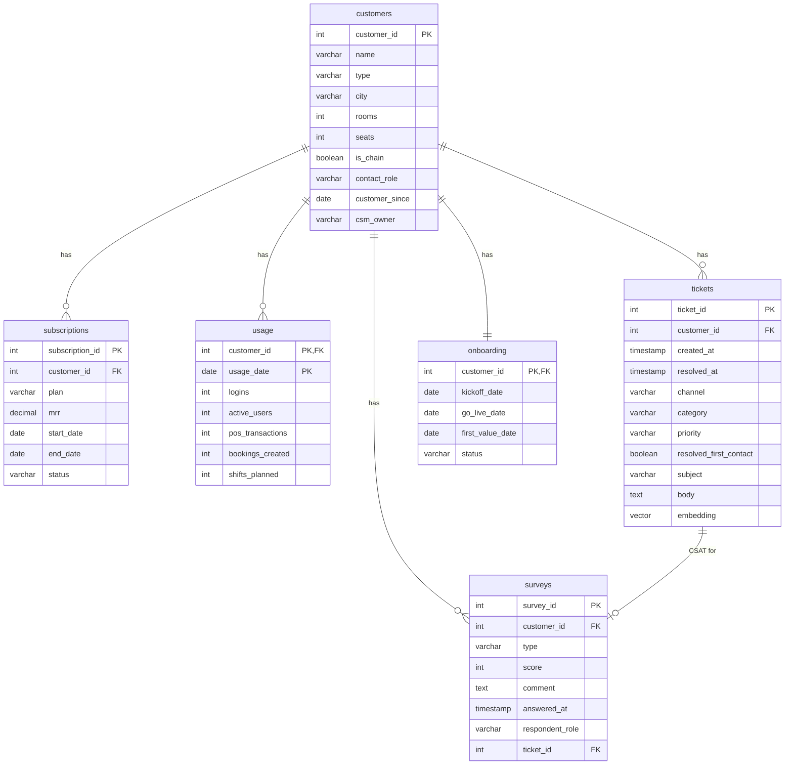

# Technical Spec: Data Model

Data model for the Customer Success Copilot, modeled on the fictional company
Gastgeber Cloud (POS, bookings, and shift planning software for hotels and
restaurants, sold on Basic / Pro / Premium plans).

## Design principles

- Values that can be calculated from other columns are not stored (e.g. time
  to value, ticket resolution time, health score). They are computed later
  from the raw tables below.
- History is kept, not overwritten: a changed subscription becomes a new row
  in `subscriptions` rather than replacing the old one.

## Entity-relationship diagram

## Tables

### customers

One row per customer — the master record.

| Column | Type | Notes / allowed values |
|---|---|---|
| customer_id | integer, PK | |
| name | varchar | |
| type | varchar | `hotel`, `restaurant`, `both` |
| city | varchar | |
| rooms | integer, nullable | number of rooms; raw number, no size category stored |
| seats | integer, nullable | number of restaurant seats; raw number, no size category stored |
| is_chain | boolean | |
| contact_role | varchar | `owner`, `general_manager`, `it_manager`, `front_office_manager`, `restaurant_manager`, `shift_supervisor` |
| customer_since | date | |
| csm_owner | varchar | name/identifier of the responsible CSM |

### subscriptions

One row per contract period (not per customer) — keeps the full contract
history as plan or price changes over time.

| Column | Type | Notes / allowed values |
|---|---|---|
| subscription_id | integer, PK | |
| customer_id | integer, FK → customers | |
| plan | varchar | `Basic`, `Pro`, `Premium` |
| mrr | decimal(10,2) | monthly recurring revenue, in EUR |
| start_date | date | |
| end_date | date, nullable | null while the subscription is active |
| status | varchar | `active`; `replaced` (ended because a new contract replaced it, such as an upgrade or downgrade); `cancelled` (customer left) |

### usage

One row per customer per day.

| Column | Type | Notes / allowed values |
|---|---|---|
| customer_id | integer, PK (part 1), FK → customers | |
| usage_date | date, PK (part 2) | |
| logins | integer | |
| active_users | integer | |
| pos_transactions | integer | |
| bookings_created | integer | |
| shifts_planned | integer | |

### tickets

One row per support ticket.

| Column | Type | Notes / allowed values |
|---|---|---|
| ticket_id | integer, PK | |
| customer_id | integer, FK → customers | |
| created_at | timestamp | |
| resolved_at | timestamp, nullable | null while open |
| channel | varchar | `email`, `phone`, `chat`, `portal` |
| category | varchar | `technical`, `how-to`, `billing`, `feature_request` |
| priority | varchar | `low`, `medium`, `high`, `urgent` |
| resolved_first_contact | boolean | |
| subject | varchar | |
| body | text | |
| embedding | vector(1536), nullable | pgvector column for `text-embedding-3-small`; filled later by an AI step |

### surveys

One row per survey answer.

| Column | Type | Notes / allowed values |
|---|---|---|
| survey_id | integer, PK | |
| customer_id | integer, FK → customers | |
| type | varchar | `NPS`, `CSAT`, `CES` |
| score | integer | range depends on `type`: NPS 0–10, CSAT 1–5, CES 1–7 |
| comment | text, nullable | |
| answered_at | timestamp | |
| respondent_role | varchar | `owner`, `general_manager`, `it_manager`, `front_office_manager`, `restaurant_manager`, `shift_supervisor` |
| ticket_id | integer, FK → tickets, nullable | only set for CSAT surveys sent after a specific ticket |

### onboarding

One row per customer.

| Column | Type | Notes / allowed values |
|---|---|---|
| customer_id | integer, PK, FK → customers | one-to-one with customers |
| kickoff_date | date | |
| go_live_date | date, nullable | |
| first_value_date | date, nullable | |
| status | varchar | `not_started`, `in_progress`, `live`, `stalled` |

## Later

A `health_score_history` table (customer_id, snapshot_date, score, and the
inputs that went into it) may be added once the health score itself is
built, so each computed score can be tracked over time without recomputing
it from scratch.
