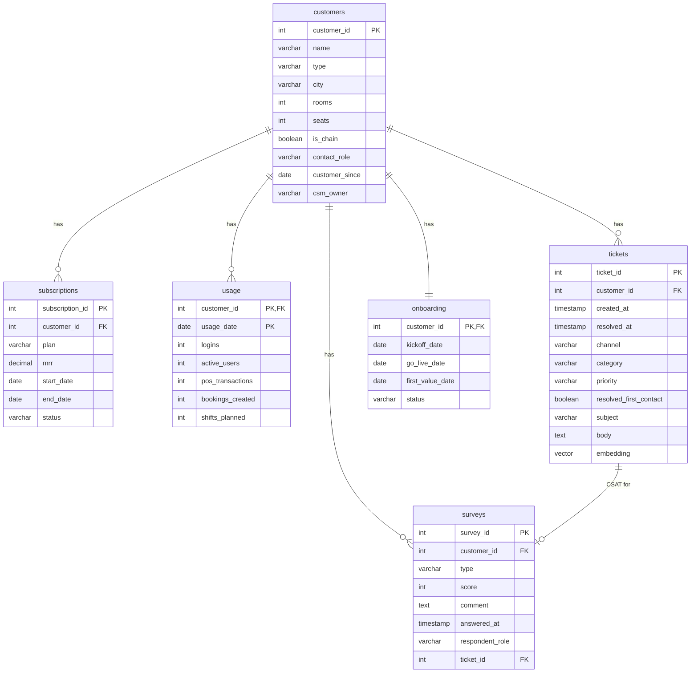

# Technical Spec: Data Model

Data model for the Customer Success Copilot, modeled on the fictional company
Gastgeber Cloud (POS, bookings, and shift planning software for hotels and
restaurants, sold on Basic / Pro / Premium plans).

## Design principles

- Values that can be calculated from other columns are not stored (e.g. time
  to value, ticket resolution time, health score). They are computed later
  from the raw tables below.
- History is kept, not overwritten: a changed subscription becomes a new row
  in `subscriptions` rather than replacing the old one.

## Entity-relationship diagram

## Tables

### customers

One row per customer — the master record.

| Column | Type | Notes / allowed values |
|---|---|---|
| customer_id | integer, PK | |
| name | varchar | |
| type | varchar | `hotel`, `restaurant`, `both` |
| city | varchar | |
| rooms | integer, nullable | number of rooms; raw number, no size category stored |
| seats | integer, nullable | number of restaurant seats; raw number, no size category stored |
| is_chain | boolean | |
| contact_role | varchar | `owner`, `general_manager`, `it_manager`, `front_office_manager`, `restaurant_manager`, `shift_supervisor` |
| customer_since | date | |
| csm_owner | varchar | name/identifier of the responsible CSM |

### subscriptions

One row per contract period (not per customer) — keeps the full contract
history as plan or price changes over time.

| Column | Type | Notes / allowed values |
|---|---|---|
| subscription_id | integer, PK | |
| customer_id | integer, FK → customers | |
| plan | varchar | `Basic`, `Pro`, `Premium` |
| mrr | decimal(10,2) | monthly recurring revenue, in EUR |
| start_date | date | |
| end_date | date, nullable | null while the subscription is active |
| status | varchar | `active`; `replaced` (ended because a new contract replaced it, such as an upgrade or downgrade); `cancelled` (customer left) |

### usage

One row per customer per day.

| Column | Type | Notes / allowed values |
|---|---|---|
| customer_id | integer, PK (part 1), FK → customers | |
| usage_date | date, PK (part 2) | |
| logins | integer | |
| active_users | integer | |
| pos_transactions | integer | always 0 for hotels (no POS) |
| bookings_created | integer | |
| shifts_planned | integer | |

### tickets

One row per support ticket.

| Column | Type | Notes / allowed values |
|---|---|---|
| ticket_id | integer, PK | |
| customer_id | integer, FK → customers | |
| created_at | timestamp | |
| resolved_at | timestamp, nullable | null while open |
| channel | varchar | `email`, `phone`, `chat`, `portal` |
| category | varchar | `technical`, `how-to`, `billing`, `feature_request` |
| priority | varchar | `low`, `medium`, `high`, `urgent` |
| resolved_first_contact | boolean | |
| subject | varchar | |
| body | text | |
| embedding | vector(1536), nullable | pgvector column for `text-embedding-3-small`; filled later by an AI step |

### surveys

One row per survey answer.

| Column | Type | Notes / allowed values |
|---|---|---|
| survey_id | integer, PK | |
| customer_id | integer, FK → customers | |
| type | varchar | `NPS`, `CSAT`, `CES` |
| score | integer | range depends on `type`: NPS 0–10, CSAT 1–5, CES 1–7 (CES: 1 = very easy, lower is better) |
| comment | text, nullable | |
| answered_at | timestamp | |
| respondent_role | varchar | `owner`, `general_manager`, `it_manager`, `front_office_manager`, `restaurant_manager`, `shift_supervisor` |
| ticket_id | integer, FK → tickets, nullable | only set for CSAT surveys sent after a specific ticket |

### onboarding

One row per customer.

| Column | Type | Notes / allowed values |
|---|---|---|
| customer_id | integer, PK, FK → customers | one-to-one with customers |
| kickoff_date | date | |
| go_live_date | date, nullable | |
| first_value_date | date, nullable | |
| status | varchar | `not_started`, `in_progress`, `live`, `stalled` |

## Generator assumptions

Fixed assumptions used by `generator/` to produce the fictional dataset
(part 1: customers, subscriptions, onboarding; part 2: usage, tickets,
surveys). All randomness uses a fixed seed (42), so the data is
reproducible. "Today" for the dataset is 2026-11-15 (`REFERENCE_DATE`): no
generated date is ever after it.

- **Customers**: exactly 200 — 150 restaurant, 30 hotel, 20 both.
- **Cities**: German cities; 40% drawn from a fixed NRW list, 60% from other
  major German cities.
- **Size**: small/medium/large, roughly 60% / 30% / 10%; used to pick
  rooms/seats, plan, and chain status, but never stored as a column.
- **Rooms** (hotel, both): small 5–25, medium 26–80, large 81–200.
- **Seats** (restaurant, both): small 15–50, medium 51–150, large 151–400
  (151+ capped at 400).
- **Chain membership**: ~10% overall, more likely for large customers
  (5% / 12% / 35% by size).
- **Contact role**: fits the customer type — restaurant: owner,
  restaurant_manager, shift_supervisor; hotel: owner, general_manager,
  front_office_manager; both: all of these. `it_manager` is added as an
  option only for large customers or chains. Customers with the
  `champion_loss` story never have `owner` as contact role (an owner
  doesn't leave their own business).
- **Plan**: Basic/Pro/Premium, ~50% / 35% / 15% overall; larger customers
  are more likely to choose Pro/Premium.
- **MRR** (EUR): Basic 120–550, Pro 220–1,100, Premium 350–1,800, split into
  size sub-bands so bigger customers pay more within a plan. A type factor
  is applied on top: restaurant ×0.6, hotel ×1.0, both ×1.4 ("both" pays the
  hotel package plus the restaurant module, with a bundle discount).
- **customer_since**: uniform between 2024-01-01 and 2026-09-30.
- **Hidden story** (never stored in the six tables — used only internally
  and in `data/generated/_truth.csv`, to avoid leaking it into the data an
  ML model would see): healthy 60%, price_sensitive 10%, low_engagement
  10%, low_adoption 10%, champion_loss 10%.
  - *healthy*: mostly stays on one plan; 20% upgrade (Basic→Pro or
    Pro→Premium) 4–16 months after start.
  - *price_sensitive*: always starts on Pro or Premium (overbought), then
    downgrades one plan level 3–8 months after start.
  - All four churn stories (including price_sensitive after its downgrade)
    cancel in about half of cases — only customers with at least 6 months
    of tenure by REFERENCE_DATE are eligible; newer customers stay active
    (at risk). Cancellation lands 6–14 months after start, bounded by
    REFERENCE_DATE. For price_sensitive, cancellation is at least 2–4
    months after the downgrade.
  - Subscription history has no gaps or overlaps: a replaced row's
    successor starts the day after the old `end_date`.
- **Onboarding**: `kickoff_date` is always 1–2 weeks after `customer_since`
  (never empty). `go_live_date` follows 3–8 weeks after kickoff; if that
  would land after REFERENCE_DATE, status is `in_progress` instead.
  `first_value_date` follows 1–4 weeks after go-live (6–10 weeks for
  `low_adoption`, who reach first value later than usual). A customer can
  only be `stalled` if the kickoff was more than 8 weeks before
  REFERENCE_DATE (enough time for go-live to normally have happened) **and**
  either has less than 6 months of tenure or cancelled within 9 months of
  `customer_since` ("cancelled early"); healthy customers never stall.

### Part 2: usage, tickets, surveys

A shared `generator/signals.py` computes a few values once so usage, tickets
and surveys stay consistent: `window_end` (cancellation date or
REFERENCE_DATE), `champion_loss_event_date` (when the champion actually
left, 50–80% of the way through the customer's tenure), the customer's
`low_engagement_decline_start` (3–6 months before `window_end`), and whether
the customer is one of the 60% of restaurants closed on Mondays.

**Usage** — one row per customer per day, `customer_since` to `window_end`.
- Daily baselines by size (Poisson means): logins/active_users/bookings_created
  scale with size; `pos_transactions` is drawn once per customer from a
  size-based range (small 30–70, medium 50–150, large 150–300) and keeps
  running regardless of story — a restaurant doesn't stop ringing up bills.
  `pos_transactions` is always 0 for hotels (no POS). `bookings_created`
  applies to all types (table reservations too), restaurants a bit lower
  than hotels of the same size. `shifts_planned` is 0 every day except
  Thursday, when a whole week's worth of shifts (one row per person per
  day) gets planned at once.
- Season: Jan/Feb ×0.6, May–Sep & Dec ×1.3, rest ×1.0. Weekday: Fri/Sat
  ×1.3. 60% of restaurants have zero usage on Mondays (closed).
- Before go-live (or if never live yet): **all** metrics, including
  `pos_transactions`, ×0.1 — there's no POS data in our system yet either.
- `low_engagement`: logins, active_users, bookings_created and
  shifts_planned (everything except `pos_transactions`) decline linearly
  from `low_engagement_decline_start` to ~20% of normal by `window_end`.
- `champion_loss`: at `champion_loss_event_date`, active_users drops to 1
  and stays there (on open days only — 0 on closed Mondays); the POS keeps
  running, but logins/bookings_created/shifts_planned drop to ×0.15 three
  weeks after the event.
- `low_adoption`: shifts_planned is 0 on ~90% of Thursdays anyway;
  bookings_created ×0.25.
- `logins` is always at least `active_users` (every active user logs in at
  least once).

**Tickets** — ~1/month per customer on average (`low_engagement` ~0.4/month,
`low_adoption` ~1.5/month).
- Before go-live, tickets are ~90% `how-to` (setup questions), always timed
  in the quiet weekday afternoon (14:00–17:00) regardless of category.
- After go-live, category follows the story (healthy mostly `technical`;
  `price_sensitive` mostly `billing`; `low_adoption` mostly `how-to`;
  `low_engagement` an even mix; `champion_loss` like healthy before the
  event, ~80% `how-to` after it).
- `technical` tickets are timed around service hours, which depend on
  type: restaurant 11:00/12:00/17:00–21:00; hotel check-out (7:00–11:00)
  and check-in (15:00–18:00); "both" either set. Weighted ×2 toward
  Fri/Sat. Non-technical tickets (and all pre-go-live ones) land on
  weekdays in the quiet afternoon instead. Closed Mondays are excluded
  from every ticket date pool.
- Priority is weighted higher (high/urgent) during service hours, lower
  otherwise.
- Channel: during service hours, mostly phone (~70%) or chat; in the quiet
  afternoon, a mix of email (~35%), phone (~20%), chat (~20%), portal
  (~25%) — people still call sometimes even outside service hours.
- `resolved_first_contact` (~70%) resolves in 15 minutes–2 hours; otherwise
  resolution time depends on priority (1–4h urgent up to 3–7 days low). A
  ticket whose resolution would land after `window_end` stays open.
- Phone tickets are logged by the agent 5–30 minutes after the call, as a
  short third-person summary ("Customer called: ..."); email/chat/portal
  tickets read as written by the customer. No LLM calls; `embedding` stays
  empty.

**Surveys** — NPS 1 month after go-live then every 6 months; CSAT for 30%
of resolved tickets (1–3 days after `resolved_at`); CES once, 2–4 weeks
after go-live. **CES scale: 1 = very easy, lower is better.**
- Comments match what the survey actually asks about: NPS comments reflect
  the relationship/story (price complaints, "too complicated," "stopped
  logging in," "our manager left," or feature praise); CSAT comments are
  about that one support interaction (fast/friendly vs. slow/unresolved);
  CES comments are about how easy or hard the setup was. Not every survey
  gets a comment — ~40% overall, ~65% for low scores (NPS ≤6, CSAT ≤2, CES
  ≥5).
- NPS respondent is usually (80%) the customer's own `contact_role`;
  `champion_loss` surveys after the event always use a different role.
  CSAT respondent is random among the customer's allowed roles, except
  `champion_loss` after the event, which also excludes the original
  `contact_role`. CES respondent is always the `contact_role` (the person
  who did the onboarding).
- `low_engagement` NPS score stays normal (7–9) before
  `low_engagement_decline_start`, then declines to 3–5 by `window_end`, in
  step with its usage decline.

## Known limitations

- Phone contacts are often not logged as tickets in real support teams, so
  our ticket counts likely underestimate real contact volume for
  phone-heavy customers. We don't simulate this — every generated phone
  call becomes a ticket.

## Later

A `health_score_history` table (customer_id, snapshot_date, score, and the
inputs that went into it) may be added once the health score itself is
built, so each computed score can be tracked over time without recomputing
it from scratch.
